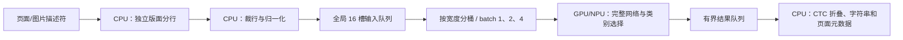

# Tesseract Fast / Best：实验性 Intel 后端

英文 Fast 与 Best 的识别网络已解析成 OpenVINO 图，实际验证 CPU、GPU 和 NPU 执行。“解析位图”增加独立的实验性 NPU 选项及简体中文/英文混合 Best 模式，默认仍是原有 CPU Tesseract。只接受已固定 SHA256 的三个模型，不支持任意 traineddata。

## 范围与结果

源代码位于 `backend/experimental/`，Python 服务仅在请求该后端时导入和初始化；不会在应用启动时加载其模型。Fast 权重反量化成 FP32，Best 浮点权重转成 FP32；NPU 默认 FP16。未实现原生 Leptonica 行归一化、卷积随机边界、Fast 整数激活舍入、LSTM ±100 状态裁剪与 DAWG/beam 解码，不能称为原生 Tesseract 等价转换。

数据与方法见 [61 页单次测试](performance/2026-10-14-tesseract-openvino-book.md)。CPU/GPU 同一原型输出完全一致；NPU 有小幅字符差异，其中包含可确认的局部退化，尚无全书人工 ground truth。NPU 的数值差异、类别输出兼容异常及 DEVICE_LOST 是三种不同问题，不统一归因于量化。

GPU batch=4 已通过全范围实际测试。当前 NPU 驱动的长行多输入执行会重置设备，故长行仅用 NPU batch=1，短行可组批；不反复重试已失败的宽度/batch 配置，不静默切到 CPU。设备端浮点归约替代了有问题的 TopK 整数输出，并检查每个类别编号。

## 生产者／消费者



16 槽覆盖排队、分桶等待和正在设备上处理的所有行输入；生产者遇满等待。结果队列也有界。没有收集全文位图；实验中最多两个活动页面，CPU 一次只打开一张原始图片。按原宽度分桶，避免为了凑 batch 改变长行的 padding 和逆向 LSTM 上下文。不足批在 20 ms 超时或输入结束时提交，空白页正常结束。

分行不调用神经网络识别；版面器是独立 Tesseract.js CPU `AnalyseLayout`。网络推理、Softmax 和类别选择均在指定 GPU/NPU 执行。CTC 去重复/空白、UTF-8 字符映射和页面坐标属于 CPU 后处理。若未来恢复 DAWG/beam 解码，也应单独计量 CPU 后处理，不宣称 OCR 完全不使用 CPU。

取消/错误会取消其余阶段、等待已经开始的 CPU 和设备操作后释放资源；输入像素与编译 profile 数有界，统计不保存每个 batch 的无限历史。Windows 实测进程树使用 Job Object 限制私有内存，退出时一并终止版面子进程。无闲置轮询、无常驻后台模型服务。

## 复现

沿用 `backend/requirements-openvino.txt`，不需要 PyTorch/ONNX。准备图片需另一个安装 PyMuPDF 的 Python；分行桥接使用项目的 Node/Tesseract.js 依赖。实际硬件测试一次只运行一组。

```powershell
# 在有 PyMuPDF 的环境准备同一范围；页码是文件页码，含首尾。
python scripts/benchmark-tesseract-book.py --prepare --pdf "完整 PDF 路径" --first 40 --last 100
# 以下使用 OpenVINO 环境；每个命令结束后再运行下一个。
python scripts/benchmark-tesseract-book.py --variant fast --device CPU
python scripts/benchmark-tesseract-book.py --variant best --device NPU
python scripts/benchmark-tesseract-pipeline.py --variant fast --device GPU --batch 4
python scripts/benchmark-tesseract-pipeline.py --variant best --device NPU --batch 4
python scripts/report-tesseract-book.py
```

Fast 读取 `public/models/ocr/eng.traineddata`。Best 读取 `.cache/tesseract-openvino/eng-best.traineddata`，来源为官方 `tessdata_best` 的 `e12c65a915945e4c28e237a9b52bc4a8f39a0cec/eng.traineddata`。只接受以下哈希；命令不会自动下载未知模型：

| 模型 | SHA256 |
|---|---|
| Fast | `7d4322bd2a7749724879683fc3912cb542f19906c83bcc1a52132556427170b2` |
| Best | `8280aed0782fe27257a68ea10fe7ef324ca0f8d85bd2fd145d1c2b560bcb66ba` |

原书图片、识别文字与差异 HTML 仅放入 `.cache`，公开报告只保留计时、哈希和计数；不随安装包分发。

## 应用中的可选后端

选择 **框选 OCR → 解析位图 → OCR 后端 → Tesseract · NPU · 实验性**。英文 Best 默认选中，也可选择 Fast；设置中的 1/2/4 表示最大识别 batch。原 CPU 后端的 1/2/4 仍表示独立 worker。

在本地模型管理安装 **Tesseract English Fast + Best**（约 18.6 MiB）及本地加速运行时，并准备原有 Tesseract 语言包供 CPU 分行使用。模型来自固定官方版本，下载后校验 SHA256。服务新增 `/ocr-tesseract-npu`；旧服务需重启。没有 NPU、模型缺失或驱动失败时明确报错，不静默 CPU 回退。

应用逐张解码图片，浏览器仅用一个英文 layout-only worker，不调用 CPU 神经识别；服务复用原有 `run_pipeline`，队列最多 16 行，最多三种编译宽度，NPU 长行 batch=1。每张结果返回测得的行框，沿用保存、搜索、选文和逐页提交逻辑。极宽行会几何拆分为有界片段，准确率需核对。

扫描完成、停止、失败和关闭时终止分行 worker；服务等待取消的设备请求结束后清空队列、归一化张量与图片。模型和最多三个编译请求按用户的闲置卸载时间保留，切换模型/批量或手动释放时关闭。没有缓存全文像素。已保存文字/行坐标按内容增长是预期数据，驱动/内存分配器也可能保留已释放的内存池，不能仅凭进程 RSS 未立即下降认定泄漏。

验证包括真实浏览器英文分行、模拟 NPU HTTP/工程保存、队列正常/取消/失败弱引用回收、输入边界和实体 NPU Best batch=2 小样本两次顺序请求（复用一个编译 profile，关闭后释放 engine）；该小样本不是新的性能均值或精度证明。后续仍需原生预处理/解码保真及人工质量回归。

格式与执行参考：[Tesseract 5.5.0 LSTM](https://github.com/tesseract-ocr/tesseract/tree/5.5.0/src/lstm)、[OpenVINO 精度控制](https://docs.openvino.ai/2026/openvino-workflow/running-inference/optimize-inference/precision-control.html)。

## 中英混合与停止修复

模型菜单增加 **简体中文 + English · 混合 Best**。本地模型管理安装 **Tesseract 中英混合 Best**（12.5 MiB），并使用更新后的运行时服务。采用官方 `tessdata_best` 固定版本 `e12c65a915945e4c28e237a9b52bc4a8f39a0cec` 的 `chi_sim.traineddata`，SHA256 `4fef2d1306c8e87616d4d3e4c6c67faf5d44be3342290cf8f2f0f6e3aa7e735b`；该模型包含汉字与拉丁字符。一个网络处理混排行，不同时驻留中文和英文两套识别模型。CPU 分行加载 `chi_sim+eng`，不进行 CPU 神经识别。

混合图输入高度为 48，英文为 36。中文字符由 2–5 个分类码表示，验证起始码/延续码字母表不相交后按原 recoder 解码；CTC blank 不误作字符边界。保留 16 行队列；混合模式暂只启用已验证的 NPU batch=1，界面会锁定该值。原英文批量设置不变。

实机三条中英合成行 CPU/NPU 字符输出相同，包含中文、英文和数字；空格有遗漏，仍为实验性，不能据此声称文档级准确率或加速。合成样本在 `.cache/tesseract-openvino/mixed`；可用 `scripts/probe-tesseract-openvino.py --variant mixed-best --device CPU/NPU --width 384 --image <line.png>` 复核单行图，命令不自动下载。GPU/NPU 的英文 61 页数据不代表混合模式性能。

CPU 1/2/4 是最大 worker 数，同时识别的输入图片总量另受 400 万像素预算限制。小图可以四路，大图自动减少并发；共享空闲 worker，避免四个固定解码 lane 轮流膨胀四套 WASM 堆。负载变小时释放闲置高水位 owner；插入图片的原始解码也串行。该像素预算不是整个进程 RAM 上限，模型、PDF 文档和已保存 OCR 数据另占内存。

停止时专用 PDF worker 立即销毁，原数据/加载/绘图/清理等待可取消；正常关闭的 transport 握手最多等待 500 ms。CPU pool 关闭会取消并排空所有活动/等待任务，再释放 owner。UI 显示停止状态并保留完成结果。测试覆盖卡住的 transport/解码等待、不同 decode lane 复用一个大图 owner、四小图并行、提前失败无遗留任务，以及实际四路 WASM 停止后 worker 归零和 UI 可操作。没有复现或排除所有硬件/内存压力下的冻结。

“耗时详情”显示累计任务、分行、设备推理、本次编译、服务处理耗时。首次分行包含语言/核心加载，服务包含图像归一化和编译；分段可能重叠，总任务时间不等同整批墙钟时间。CPU 仍为默认，NPU 不保证更快或更省电。
